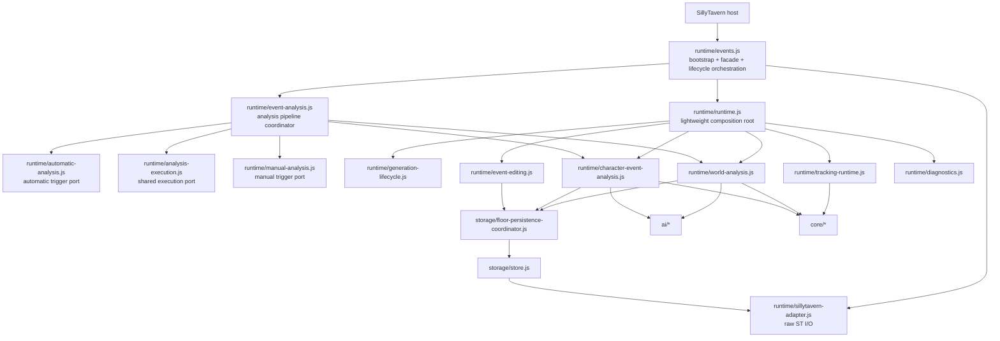

# BioWeave 当前架构导航

本文是当前工作树的 canonical developer navigation。它说明“一个功能由哪里负责”、模块之间允许怎样依赖，以及修改某类问题时的第一落点。历史 Trellis task 的 PRD、design 和 implement 文档保留为历史记录，不作为当前模块地图。

## 总体边界

BioWeave 的基础架构重构已完成。后续优先修产品行为，不再为了文件大小继续拆分；只有形成独立生命周期、状态边界或可独立测试职责的新功能，才创建新的 feature module。



依赖方向的硬规则：Adapter 不依赖业务 feature；feature 不直接依赖 UI 或 SillyTavern transport；Storage 不依赖 runtime feature；Generation Lifecycle 不反向导入 `events.js`；普通 Floor 写入不绕过 Coordinator；Host/Floor Recognition 不依赖 Automatic Scheduler；Automatic Scheduler 只依赖 Shared Analysis Execution port，不依赖 World/Event/Tracking/Projection 具体实现；Shared Analysis Execution 不依赖 Automatic Scheduler；Manual Analysis 不修改 Automatic Scheduler 内部状态。

## Feature-to-file map

| Feature | Primary owner | 负责什么 |
| --- | --- | --- |
| Runtime Diagnostics | `runtime/diagnostics.js` | trace 缓冲、payload 安全格式化、diagnostic DTO 和查询；Health Assessment、Story Time-driven Projection timing/eligibility/AI/readback、Floor transaction、Projection Context slot 与 generation-boundary trace 复用同一 Settings Debug buffer/export，敏感正文不进入 exporter |
| Event Editing | `runtime/event-editing.js` | 已存在 Biological Event 的 update/delete workflow |
| Tracking Runtime | `runtime/tracking-runtime.js` | 从有效 Floor facts 重建并刷新 Tracking Registry |
| World Analysis | `runtime/world-analysis.js` | World 查询、Full/Supplement/Patch、World AI orchestration、结果 readback/readiness；业务语义见 [World Model and World Analysis Contract](../.trellis/spec/domain/world-model.md) |
| Character/Event Analysis | `runtime/character-event-analysis.js` | Event AI、parse/normalize、identity、Event patch、readback 和成功后的桥接 |
| Projection Runtime | `runtime/projection-runtime.js` | factual success 后的 evolution、eligibility、single-flight、generation、stale guard、Floor persistence readback、Runtime DTO 和 Projection Refresh |
| Generation Lifecycle | `runtime/generation-lifecycle.js` | generation intent、settle barrier、supersede、exactly-once handoff |
| Automatic Analysis Port | `runtime/automatic-analysis.js` | settled Character Floor 的自动观察入口、只读 scheduler state 和 lifecycle reset；不拥有 scheduler implementation |
| Shared Analysis Execution Port | `runtime/analysis-execution.js` | automatic/manual 共用的单一 execution seam；不拥有 scheduler state |
| Manual Analysis Port | `runtime/manual-analysis.js` | 用户主动 refresh、Character/Event 和 current-floor 分析入口；不修改 scheduler state |
| SillyTavern Adapter | `runtime/sillytavern-adapter.js` | 原始 Host context、Chat/Floor slot I/O、HTTP transport、listener subscribe |
| Runtime Composition | `runtime/runtime.js` | create / inject / assemble / return；不拥有业务状态 |
| Analysis Pipeline Coordinator | `runtime/event-analysis.js` | execution ownership、runAnalysis、generic retry、scheduler、World→Event pipeline、terminal 和 shared bridges |
| ST integration / compatibility facade | `runtime/events.js` | 顶层 bootstrap、public facade、lifecycle orchestration、source cleanup 和冻结的 persistence-policy bridge |
| Floor Persistence Coordinator | `storage/floor-persistence-coordinator.js` | ordinary owner-scoped Floor transaction、merge、save、readback、confirmed decision |
| Projection | `storage/projection.js`、`storage/projection-timing.js`、`runtime/projection-runtime.js` | `projection_timeline` 与 `projection_timing_snapshot` 的 Floor-owned owner workflow；Runtime post-processing 与 readback |
| Participant aggregation | `core/participant-aggregation.js`、`storage/participant-aggregation.js` | 独立 `participant_aggregation_snapshot` 完整 Floor 集合的 frozen Timing 触发、Floor-owned success readback、当前 Event 快照名单派生与 Projection evidence 校验；当前 Timing Instance 的显式人工编辑成功后由 Runtime 重新评估同一 Cycle；不拥有 Timing、Tracking Window 或生命周期解锁 |
| Pregnancy lifecycle archive/release | `core/pregnancy-lifecycle.js`、`storage/pregnancy-lifecycle.js` | 独立 `pregnancy_lifecycle_timeline` 的 confirmed lifecycle fact、父方候选/证据归档、当前 cycle 精确 Exposure 快照删除与 release readback；不改写历史 Floor、不拥有 father UI |
| Storage primitives | `storage/store.js` | Floor/Chat storage abstraction 与 host-store compatibility |
| Clear / special lifecycle | `storage/clear.js` | explicit clear、restore/migration 和特殊生命周期操作 |
| AI input construction | `ai/input-builder.js` | AnalysisInput 收集、选择、清洗和规范化 |
| Analyzer boundary | `ai/analyzer.js` | analyzer invocation、raw response 解析和结果规范化入口 |
| Prompt construction | `ai/prompts.js` | World/Event 等 analyzer prompt 和 contract |
| Character Evidence projection | `ai/input-builder.js` | 从 raw/runtime sources 构建 source-specific semantic Character Evidence；不创建 canonical identity |
| Character identity domain | `core/identity.js` | canonical ID、existing/new/unresolved、alias candidate 与 registry invariants |
| Tracking domain | `core/tracking.js` | eligibility、candidate/subject derivation 和 registry rebuild algorithm |
| Pregnancy Exposure Tracking lifecycle | `core/tracking-window.js`, `runtime/tracking-window-runtime.js`, `storage/tracking-window.js` | Phase 1 identity/grouping plus Phase 2 Timing-bound Story-Time lifecycle and Floor persistence; World `tracking_window_horizon` remains configuration/evidence but cannot split or expire a Window before the frozen Timing boundary |
| Snapshot domain | `core/snapshot.js` + `runtime/event-analysis.js` | Floor-owned checkpoint validation/persistence；完整当前 `floor.events` 直接作为 StateReducer 输入，避免再次 replay 累计状态 |
| State domain | `core/state.js` + `runtime/event-analysis.js` | `reduceState()` 与 `getCurrentBiologicalState()` 的 derived Current Biological State path |
| Health Assessment | `core/health-assessment.js` + `runtime/health-assessment.js` | Core 只对明确健康事实且具有 factual `health_role: observation` 的 Event 做 eligibility、fingerprint、schema v3 normalize/validate、observation-level severity、one-time recovery profile 与 source-bound active filtering；非健康 `other_biological` fail closed，`intervention` 不触发 Assessment；Runtime 负责独立 Assessment AI pass、stale guard、Floor persistence/readback；不写回 BiologicalEvent factual payload；旧 v1/v2 记录不补评估，缺少 v3 profile 时不产生 staged Guidance |
| Event/Floor complete state | `runtime/event-analysis.js` + `runtime/character-event-analysis.js` + `runtime/event-editing.js` + `storage/floor-persistence-coordinator.js` | 所有 BiologicalEvent 的新增、修改、删除和历史恢复都通过最近有效完整集合与当前 `event` owner；当前 Floor 一次写回完整 `floor.events`，继承 Event 保留原始 `source`，不修改历史 Floor |
| Health Evolution | `core/health-evolution.js` + `runtime/health-evolution.js` + `runtime/event-analysis.js` | Core/Runtime 纯计算 Current Health State 与到期 Event ID；到期判断由 Health Evolution 提供，完整集合写回复用通用 Event/Floor 机制，不调用 AI、不修改历史 Floor |
| Health Aggregation | `core/health-aggregation.js` | 仅按 factual `body_site + laterality` 构建 active observation site-oriented presentation group，保留 `health_observations[]` 与 canonical source Event IDs；intervention 仅保留在 Event history，不进入 Current Health DTO；不拥有 lifecycle、Assessment 或 treatment authority |
| Health Recovery Guidance | `core/health-recovery-guidance.js` + `runtime/projection-context.js` | 根据 Story Time deterministic 选择阶段并消费 persisted observation-specific recovery profile，组合进唯一 `bioweave_projection_context` 槽位；不生成通用医学文本 |
| UI orchestration | `ui/app.js` | overlay、页面动作和 Runtime API 调用 |
| Characters UI | `ui/characters.js` | Characters 页面渲染；当前主要枚举 `tracking_subjects` |

### Health extension rule

Health 的 pure domain ownership 位于 `core/health-assessment.js`、
`core/health-evolution.js`、`core/health-aggregation.js` 与
`core/health-recovery-guidance.js`；runtime orchestration 位于
`runtime/health-assessment.js` 与 `runtime/health-evolution.js`。Generic runtime 只提供
narrow hooks：调用、DTO forwarding、persistence/lifecycle/stale guard 和协调，不拥有
Health business rules。`ui/characters.js` 只做 presentation，不重算 lifecycle、severity
或 recovery；`ui/app.js` 只做页面 orchestration。

当前 observation-level severity 属于 Health Assessment contract；由 active observations 派生的
`severity_summary` 是 Health read model 的 presentation-only 字段，不是完整 `overall_health`，
也不改变 Event、Snapshot、Projection 或 Assessment。UI 只消费该字段，不维护排序。未来新增
Health 能力应优先采用：

```text
small pure core module
  → explicit DTO
  → narrow runtime coordinator/hook
  → presentation-only UI
```

禁止创建 Health Manager / God module，也不得把 Health 规则塞入
`runtime/event-analysis.js`、`runtime/events.js`、`ui/app.js`、`ui/characters.js` 或
generic StateReducer。functional impact、完整 overall health summary、超出固定展示排序的
severity aggregation、long-term progression 与 explicit recovery reference resolution 均需独立的真实产品 contract 后再设计，
不能通过预留空模块提前冻结。

## Where do I change this?

| Problem / feature | 第一站 | 可能的第二站 | 通常不要先改 |
| --- | --- | --- | --- |
| World analysis bug | `runtime/world-analysis.js` | `ai/analyzer.js`、`ai/input-builder.js`、`ai/prompts.js` | `floor-persistence-coordinator.js`、Adapter |
| Character/Event analysis bug | `runtime/character-event-analysis.js` | `core/events.js`、`core/identity.js`、AI 层 | `runtime/generation-lifecycle.js` |
| Manual World action | `runtime/world-analysis.js` | `runtime/event-analysis.js`、`ui/app.js` | Persistence transport |
| Manual Character action | `runtime/event-analysis.js` explicit `analyzeCurrentCharacterEvents()` routing | `runtime/world-analysis.js` read-only World prerequisite、`runtime/character-event-analysis.js`、`ui/app.js` | Adapter、Generation state、`resolveFinalWorldModelForAnalysis()` |
| Event parsing/normalization | `core/events.js`、`ai/analyzer.js` | `runtime/character-event-analysis.js` | UI |
| Event editing | `runtime/event-editing.js` | `core/events.js`、`core/identity.js` | Event AI stage |
| Character identity | `core/identity.js` | `runtime/character-event-analysis.js` | `core/tracking.js` |
| Tracking behavior | `core/tracking.js` | `runtime/tracking-runtime.js` | `character_registry` persistence |
| Characters UI | `ui/characters.js` | `ui/app.js`、business DTO bridge | Event persistence schema |
| Generation auto-trigger | `runtime/generation-lifecycle.js` | `runtime/events.js` host forwarding、`runtime/automatic-analysis.js` port、`runtime/event-analysis.js` compatibility wiring | World/Event implementation |
| Generation settle | `runtime/generation-lifecycle.js` | lifecycle tests | Persistence |
| Retry behavior | `runtime/event-analysis.js` | World/Event attempt modules | Generation state |
| Scheduler | `runtime/automatic-analysis.js` port + `runtime/event-analysis.js` current implementation | settings/runtime wiring | Adapter、World/Event/Tracking/Projection implementation |
| Diagnostics | `runtime/diagnostics.js`、`utils/world-model-debug.js` | caller-specific trace emission、World LIVE STATE fingerprint/diff | General event bus、Floor writers |
| AI input construction | `ai/input-builder.js` | `runtime/event-analysis.js` caller | Persistence |
| World prompt | `ai/prompts.js` | `ai/analyzer.js` | Event runtime |
| Event prompt | `ai/prompts.js` | `ai/input-builder.js` | World runtime |
| Snapshot | `core/snapshot.js`、`core/state.js` | `runtime/event-analysis.js` checkpoint bridge | Adapter |
| Current Biological State | `core/state.js` | `runtime/event-analysis.js` replay/read API | UI business logic |
| Projection | `runtime/projection-runtime.js`、`storage/projection.js`、`core/projection.js` | `ui/projection.js`、Context injection | World/Event direct writes |
| Floor persistence | `storage/floor-persistence-coordinator.js` | owner caller、`storage/store.js` | direct host save |
| F5 durability | Coordinator + `storage/store.js` + Adapter bridge | `REAL-HOST VERIFIED` after automated mechanism tests | analysis modules |
| Swipe ownership | `runtime/floor.js`、`storage/store.js` | Coordinator/Adapter raw slot access | UI-only code |
| ST HTTP transport | `runtime/sillytavern-adapter.js` | `runtime/events.js` compatibility bridge | business feature |
| ST lifecycle listener registration | Adapter subscribe API | `runtime/events.js` callback wiring | Generation module |
| Source cleanup | `runtime/events.js`、`storage/clear.js` | lifecycle contract | Adapter policy |
| Settings | `ui/settings.js`、settings/storage callers | `runtime/events.js` host/settings glue | new Settings service |
| Clear/reset | `storage/clear.js` + owning runtime bridge | `runtime/events.js` orchestration | ordinary Floor writer |

### World Model Debug LIVE STATE boundary

Settings Debug keeps two explicitly different data sources:

```text
user action (open / refresh / copy)
→ ui/app.js collectWorldModelLiveState()
→ Runtime transient diagnostic state (read only)
→ existing authoritative World/Floor resolver (read only)
→ current ui/app.js World state
→ last World render diagnostic
→ utils/world-model-debug.js fingerprint / comparison / address diff
→ WORLD MODEL LIVE STATE + HISTORY TRACE output
```

`WORLD MODEL LIVE STATE` is sampled at the action boundary and includes its own
snapshot ID, started/completed timestamps, six-field target identity, layer
fingerprints, dynamic addresses, consistency status, and target-change
invalidation. `HISTORY TRACE` remains the event buffer returned by
`runtime/diagnostics.js`; it is labeled as historical and is never used as a
substitute for current Runtime, Floor, UI, or renderer state. The collector has
no Floor writer, does not call analysis or repair, and does not alter the
canonical `saveWorldModel → commitFloorPatch(owner="world") →
FloorPersistenceCoordinator` path.

Settings Debug 的“当前生产业务状态”通过
`runtime.collectActiveBusinessData({includeDebug: true})` 采样，不维护第二套业务计算。
采样 DTO 固定绑定 Chat、目标 Floor、active Swipe 和完整六字段 Floor Version，并分别标记
`CURRENT_DERIVED`、`CURRENT_RESOLVED` 与 `HISTORICAL_PERSISTED` 数据来源。Event、World Model
和 Character Registry 显示最近有效完整状态及其来源 Floor；Tracking Window 与 Tracking Registry
直接显示同一次生产派生结果，不能使用旧 `tracking_window_timeline` 代替当前结果。采样在目标变化
后标记 stale，调试读取不写入 Floor，也不跨刷新缓存。

Health/Recovery diagnostics 也只进入同一 `BIOWEAVE_PERSISTENCE_TRACE` buffer 和现有
Debug export，不创建 Health 专属日志或 persistence root。`HEALTH_ASSESSMENT_REQUEST_STARTED`
只在真正调用 Assessment analyzer/API 前记录；`REUSED` 与 `INFLIGHT_REUSED` 分别表示已
复用 persisted Assessment 或同进程请求。Recovery stage 与 Guidance trace 观察 Health-owned
deterministic 结果和 persisted profile selection，不重新计算 lifecycle 或调用 AI。Projection
trace 记录唯一 `bioweave_projection_context` 槽位的输入、写入/清除和 fingerprint；
生成正文期间，`GENERATION_STARTED` 只推进
`runtime/generation-lifecycle.js`，保留已有 Projection Context slot，不执行完整 Context
刷新、Projection lifecycle、Tracking、超时判断或 Floor 保存。期间的 Chat/消息/Swipe 自动触发由
`runtime/events.js` 合并暂存；最终 Character Floor 确认，或明确停止/取消后，才解除非阻塞
Generation gate，并通过当前 Chat、active Swipe 和完整 Floor Version guard 重放一次后处理。
若发生 Chat 边界，旧 slot 会先清空；属于旧 Chat 的延后事件会丢弃，新的 Context 只能在
gate 解除后重建。

NSFW 自动聚合诊断也复用 `runtime/diagnostics.js` 的有限 Runtime buffer，不创建业务状态或
新的 Floor 持久化根。自动调度、Projection process 与
`runtime/events.js::resolvePreConfirmationTiming` 共用一个 `run_id`；每个 stage 同时保留
`CURRENT_STATE`、`EXECUTION_TRACE` 或 `DERIVED_DIAGNOSTIC` 来源标记，以及 Chat、Floor/Swipe、
Subject、Cycle 关联。`runtime.collectActiveBusinessData({includeDebug: true})` 在既有
`business_debug` / `lifecycle_runtime` 之外输出 `diagnostic_metadata`、
`nsfw_pipeline_diagnostics`、`timing_diagnostics`、`aggregation_diagnostics` 和
`timing_performance_diagnostics`。后者是有界的前端操作 Trace，保留 Timing 编辑器操作（打开、恢复默认、保存）以及人物页
打开/选人/列表与详情局部渲染记录；按同步/异步阶段记录人物数量、渲染范围、HTML 构建与 DOM 提交耗时，并在保存操作中记录
持久化/readback/Aggregation 重评估结果。持久化阶段还按同一 `operation_id` 记录请求准备、Coordinator 队列等待、执行、owner 获取与当前性校验、Snapshot 合并、no-op 决策/收尾、
`store.saveFloor` 边界、权威回读以及宿主保存等待（宿主没有实际保存时不产生该阶段）；no-op 会将 `STORE_SAVE_FLOOR` 标为 `NOT_APPLICABLE`，不包含聊天正文或完整 Snapshot。人物页已挂载时，选人只更新列表选中状态并替换详情
pane，不重新构建无关人物列表；无法安全局部更新时回退完整页面渲染。Settings Debug 只格式化这份 DTO，最多展示最近八次
操作及其阶段耗时，不重新读取或重算业务状态。

`lifecycle_runtime.observation_boundary` 是同一只读 DTO 的观察轮次诊断：
它按成功 aggregation 保留当前 Floor/Swipe 边界、冻结状态、accepted
Exposure IDs、聚合后排除的当前有效 Exposure IDs 与 reason code、冻结的
`effective_max_story_days`、elapsed Story days、timeout status，以及可为
`null` 的 pregnancy ID、closure/release reason 和 deleted-event count。elapsed
以本轮首次 Exposure 的 reference Story Time 为起点；正常终止生命周期会显示
`released/terminal_lifecycle`，而不是误报为尚未清理。这些字段只用于判断后来事件为何没有进入本轮、以及本轮是否已经超时释放，
不写入第二事实源，也不输出正文、secret 或 raw prompt。

Timing 保存的官方 Chat I/O 也记录在同一个有界操作 Trace 的 `official_io_calls` 中。记录点位于
`runtime/sillytavern-adapter.js` 的真实 `fetch` 边界，而不是仅统计上层包装函数；每次调用用
`io_call_id` 关联 `floor_transaction_id`、`persistence_kind` 和 `io_purpose`，并分别记录
`CHAT_GET` / `CHAT_SAVE`、请求等待、响应体读取、JSON 解析、owner 规范化、`sourceRevision` 与 Floor slot
提取耗时；当响应对象只提供已经合并读取/解析的兼容接口时，两个拆分字段保持 `null`，不估算。
当前 Adapter 不缓存官方 Chat GET，因此 `cache_status` 为 `NOT_USED`。这些记录只解释
Owner Acquisition、Latest Slot、保存前读取、保存后 Adapter readback、最终 slot audit 与
Coordinator readback 的实际成本，不复用或删除任何权威读取，也不记录 Chat 正文、完整请求、响应或 Snapshot。

诊断 readback 只复用现有只读权威读取；Timing/Aggregation 业务入口不会因为采集诊断而额外
创建实例、聚合、调用 AI 或改变持久化顺序。没有可见执行 Trace 时使用 `TRACE_UNAVAILABLE`
或 `UNKNOWN`，不把当前缺失的 Timing Instance 反推为历史上未调用；Timing Instance
由当前有效的 pregnancy-relevant Exposure、人物配置和既有 Story Time 机制创建，
不依赖 `projection_rules`；规则为空不阻断 Timing 或到期后的 Participant Aggregation。
正式 Participant Aggregation 成功且存在有效 Timing/Tracking Window 时，Projection Runtime
使用插件内置的 `pre_confirmation_observation` 分支规则生成三段、每段四条确定性的中性候选
（第 14–20 天为嗜睡或疲倦、乳房敏感、气味或食物轻微变化、暂时无明显反应；第 21–27 天为
恶心、气味不舒服、情绪变化、食欲变化；第 28–42 天为恶心加重、可能孕吐、持续疲倦、一直无明显反应）；这些候选不创建
BiologicalEvent、pregnancy fact 或 `pregnancy_id`，ST 正文与 Event Analysis 仍是怀孕事实确认边界。
内置分支按经过的 Story Time 分段触发；未达到对应时间段的分支不会提前生成。Projection DTO 和持久化候选
保留参考时间、当前时间与 elapsed days。旧版立即触发的内置候选在首次运行新规则时只做 Projection
生命周期删除并重新生成，不删除事实 Event 或改写 Timing/Aggregation。
升级前一版插件留下的单条中性占位 Projection 时，Runtime 只将该旧生成物标记为删除，保留
正式候选、Exposure 与 Aggregation 历史，不会删除用户的事实 Event。
若没有有效 Aggregation/Timing 依据，则保持无候选，并在诊断中区分空规则与无候选。当前 Event
快照只缺少部分已接受来源时，新候选只使用仍然有效的当前来源，历史 Aggregation 名单不被改写；
Debug 在 `aggregation_evidence_invalid_event_ids` 中列出具体缺失/失效 ID，也不会把这些来源重新带回当前
事实。只有所有已接受来源都失效时，才失败关闭；已经保存、仍引用失效来源的旧 Projection 仍会被隐藏。

人物级 Timing/Aggregation 诊断另外保留 Tracking Window 的权威 Cycle、首次有效
Exposure、候选/accepted Exposure、最终 Cycle 及 `cycle_id_source`；`cycle_id_consistent`
与 `cycle_id_consistency_reason_code` 用于显式报告 Tracking Window Cycle 与最终周期是否匹配，
不得用最终实例字段覆盖前者。配置基础区间、variance/offset、effective 区间、Aggregation
到期/overdue/已有结果和 `readback_attempted`、`readback_succeeded`、
`readback_result_present`、`readback_reason_code` 分开输出；首次创建阶段另记录
`sampled_offset_source`、`frozen_offset_status` 和 `rng_source`，用于区分真实初始采样、冻结复用
与未创建；其中 readback succeeded 只表示
只读权威读取成功，结果是否存在由 result_present 表示。`projection_diagnostics` 单独报告
规则可用性、Eligibility、Timing Window 和 Projection 调度，不把空规则解释为 Timing
或 Aggregation 的阻断；诊断还标记内置候选来源与是否实际调用 AI。

## Feature module creation rule

1. 已有 feature owner 能完整说明职责时，扩展该 owner。
2. 只需要少量 shared orchestration 时，通过 `event-analysis.js` 或 `runtime.js` 的 narrow capability wiring 连接，不注入整个 coordinator。
3. 只有独立生命周期、独立 state/behavior boundary、清晰 public capability 或可独立测试的完整职责，才创建新 feature module。
4. 不要把新的独立 feature 继续堆进 `runtime/events.js` 或 `runtime/event-analysis.js`。
5. 不要为了一个 helper 或一个 function 创建碎片 module。

原则是 **ONE FEATURE OWNER, NOT ONE FUNCTION PER FILE**。

## 两个仍然较大的 Runtime 文件

### `runtime/events.js`

它不是通用 feature dumping ground，但仍是顶层 ST integration shell、compatibility facade、lifecycle orchestration、source cleanup integration、settings/enabled glue 和冻结 persistence-policy bridge 的组合边界。以下路径是 KNOWN-GOOD / FROZEN：

- `inspectOfficialFloorOwner`
- `acquireAuthoritativeFloorOwner`
- `bootstrapOfficialFloorOwner`
- `saveOfficialFloorSlot`
- host-ahead classification
- official readback / confirmed logic

普通产品功能不得为了方便进入这些路径。

### `runtime/event-analysis.js`

它是 Analysis Pipeline Coordinator，合理保留：`runAnalysis`、execution ownership、cancellation/supersede、generic retry、scheduler、Floor resolver/version guards、World→Event transition、terminal handling、Snapshot/general-derived-state bridge 和 capability wiring。它不是 World、Character/Event、Tracking、Event Editing、Generation state machine 或 Adapter 的 feature owner；新功能不应默认加入这里。

## Generation Lifecycle boundary

`runtime/generation-lifecycle.js` 拥有 pending generation intent、Swipe generation intent、sequence/token、completed markers、`final_character_floor_seen`、`generation_ended`、settle barrier、exactly-once consume、supersede、stop/cancel cleanup、generation diagnostics 和 settled handoff。

核心 invariant：

```text
final_character_floor_seen === true
AND generation_ended === true
→ GENERATION_SETTLED exactly once
```

`CHARACTER_MESSAGE_RENDERED → GENERATION_ENDED` 与反向顺序都必须工作。该模块不拥有 World/Event pipeline、generic retry、scheduler、Persistence、Floor Version policy 或 ST listener registration。

## SillyTavern Adapter boundary

`runtime/sillytavern-adapter.js` 负责 **HOW**：context/settings/raw metadata、Chat/message/Swipe raw access、official GET/SAVE transport、host save request、raw Floor slot read/write、lifecycle subscribe/unsubscribe、prompt host call 和 transport normalization。

它不负责 **WHY**：owner acquisition、Floor Version、stale、host-ahead、sibling merge、confirmed decision、Generation state、World/Event behavior 或 source cleanup policy。新的 ST I/O primitive 放 Adapter；新的 persistence/business decision 不放 Adapter。

## Persistence canonical path

ordinary Floor write path：

```text
World / Event / Event Editing / Projection / Terminal
→ owner-scoped patch
→ FloorPersistenceCoordinator
→ current host Context Floor view + identity guards
→ owner-scoped Snapshot merge
→ host sync
→ native saveChat()
→ one official authoritative readback
→ confirmed
```

Owner whitelist：

| Owner | Allowed fields |
| --- | --- |
| `world` | `world_model`, `world_model_meta` |
| `event` | `analysis`, `events`, `character_registry` |
| `projection` | `snapshot`, `projection_timeline`, `projection_timing_snapshot` |
| `tracking` | `tracking_window_timeline` |
| `participant_aggregation` | `participant_aggregation_snapshot` |
| `lifecycle` | `pregnancy_lifecycle_timeline`, `events` |
| `health` | `health_assessment_timeline` |
| `terminal` | `analysis` |

普通业务模块不得直接调用 `store.saveFloor`、`/api/chats/save`、`context.saveChat`、`saveOfficialFloorSlot`，也不得直接写任意 `extra.bioweave` 或 `swipe_info[*].extra.bioweave`。Chat clear、source cleanup、lifecycle root invalidation、migration/restore、metadata/settings 和 explicit Floor clear 是特殊操作，不是 ordinary owner-patch precedent。

## Persistence safety boundary

以下内容未经 root-cause evidence 不应修改：

- `storage/floor-persistence-coordinator.js`
- `runtime/sillytavern-adapter.js`
- `runtime/generation-lifecycle.js`
- `runtime/floor.js`
- `runtime/events.js` 中的 Context identity guard、native save、readback/confirmed 路径

这些路径的当前状态为：`IMPLEMENTED`；自动化测试已覆盖 Context-first persistence
mechanism。SillyTavern 1.19.0 临时 Chat 的 Context 写入、native save 和官方
readback 已在前置 Host 验证中通过，但本任务没有对正式 Chat 做写入，也没有把
跨标签页/设备并发描述成宿主保证。与产品行为无关的问题不得顺手触碰它们。

## World 与 Character/Event

World Analysis 的 domain owner 是
[`World Model and World Analysis Contract`](../.trellis/spec/domain/world-model.md)：
Full 使用 permitted evidence 重建 complete model，Supplement 使用同一 evidence
set 加 Existing canonical baseline，经过 JSON Fact Delta、Fact validation、canonical
address resolution、Existing comparison 和当前 Fact Delta safety boundary，再由
deterministic code 生成 Host-internal Patch v2 operation、classification 与
classified merge，经过 shared complete-model consistency 与 strict canonical
validation 后持久化。Supplement 的 wire format 是 JSON Fact Delta；Patch v2
不是 AI output format、Supplement wire format 或 raw model response contract。
Projection rule 的世界级修正使用同一 Fact Delta 边界：明确的
`Projection_Rule_Override` 才能生成 `DISABLE_PROJECTION_RULE`；缺少证据、
不确定性或 omission 不会移除 Existing rule。最终 active World snapshot
直接成为 Runtime authority，Runtime 不维护 disabled-rule blacklist；历史
Floor 与已有 Projection 不回写。
本文只保留模块导航，不复制该领域算法；Floor/Swipe ownership 仍以 Floor State
Ownership Contract 为准。

### 当前实现与目标契约

当前代码已实现 Manual Character 的独立分析边界：它通过 `analyzeCurrentCharacterEvents()` 读取现有 at-or-before canonical World，不进入 `resolveFinalWorldModelForAnalysis()`，因此不会触发 World AI。缺少可用 World 时以 `WORLD_MODEL_REQUIRED` fail closed，且不写 Event 或 terminal failure。Event prompt 通过 input builder 的 narrow semantic projection 消费 persisted World Model、Current Target Floor、Recent Story、`identity_context`、Character Evidence (`individual_evidence`)、bounded `existing_events` 和 Story Time；raw Character Card、Persona、Worldbook、External Memory 不直接进入 Event prompt，但 Character Card/Persona 的稳定人物证据必须先经过 projection。

目标契约为：

```text
AUTO:             World → Event
MANUAL WORLD:     World only
MANUAL CHARACTER: existing persisted valid World → Event only
                  WORLD_AI_CALLS = 0
                  no valid World → fail closed
```

Analysis Boundary Fix 与 Event Input Boundary Fix 均已实现；Event Input Boundary 不改变 World Analyzer 对 raw Character Card、Persona、Worldbook 和 External Memory 的既有输入。

World feature 以宿主可选来源构建 World Model；Character/Event feature 以已持久化 `world_model`、narrative discovery window（Current Target Floor + bounded Recent Story）、`identity_context`、Character Evidence (`individual_evidence`) 和 bounded existing Events 产生 `events`、`character_registry` 与 `analysis`。正确边界是 `raw/source collection → Character Evidence semantic projection → Character/Event Analyzer`：Runtime wide DTO 可以保留 raw sources 供 World/legacy orchestration，但 Event prompt 不消费 raw sources，也不能因隔离 raw DTO 而失去稳定人物证据。

Event persistence 使用单一完整状态语义。发生变化的 Floor 将继承当前位置之前最近的合法完整 `floor.events`，再保存变化后的完整集合；没有状态变化的 Floor 不为了复制状态而写入 Event 状态。Event 的 `source` 仍保留原始事实来源，当前 Floor slot owner 与 Event source 分开。`existing_bioweave` 与 `existing_events` 只读取最近合法完整状态，不再把多个完整 Floor 的 `events` 聚合或重复 replay；显式成功状态的 `events: []` 会阻断继续回退。该状态仍只存在于当前 message/Swipe Floor slot，不是 Chat-level Event cache。

Character Evidence 只提供 mention identity context、已有 World Model species/type mapping evidence、明确个体生理/生殖 capability evidence 与稳定人物背景。它不是当前 Floor Event、World Model rule、Tracking eligibility、Character Registry identity source 的替代品、Chat-level 持久化字段或 UI 人物列表来源。生理性别可参与已有 type mapping，但不得直接推出 capability；Human baseline 只能由 World Model 建立，Nonhuman 不能套用 Human baseline。未来修改 Event Input Boundary、Prompt trimming 或 AnalysisInput narrowing，必须保留等价 projection，并用最终 `buildEventAnalysisMessages()` 测试验证。
每个已确认 Event participant 都必须执行完整的人物分析，不以 `pregnancy_relevance.relevant === true` 为前提：identity → Character Evidence → species → species 内 biological_type → exact persisted World Model species/type → baseline capabilities → explicit individual capability evidence → final participant biological facts。`pregnancy_relevance` 只描述当前 Event，不能跳过人物 facts，也不能由人物 capability 反推妊娠相关性；证据不足保持 `null`。Tracking 继续消费最终 participant facts，Characters UI 继续消费 `tracking_subjects`，Registry 不直接成为人物列表。

## Character Registry 与 Tracking Subjects

`character_registry` != `tracking_subjects`。

- `character_registry`：Floor-owned canonical identity snapshot。
- `tracking_subjects`：runtime-derived Tracking projection。
- Characters UI 当前主要枚举 `tracking_subjects`。

`character_profiles` / `characterFacts` 也不是 Registry 或 Tracking Subject 的
别名：它们是 Runtime 为 StateReducer 构建的 derived biological/profile facts，
当前没有独立 authoritative persisted Character Profile root。Current Biological
State 则是 Events replay、characterFacts 与 Story Time 的 derived 输出；它不是
事实存储。

人物身份的 canonical pipeline 是：

```text
narrative mention
  → identity_context + Character Evidence + previous valid registry snapshot
  → AI identity classification
  → Runtime canonical identity resolution
  → participant canonicalization / Event validation
  → current Floor character_registry snapshot
  → BiologicalEvent
  → tracking_subjects / tracking_candidates
  → Characters UI
```

`core/identity.js` 是 identity domain owner；`runtime/character-event-analysis.js`
负责 Runtime resolution/canonicalization；`ai/input-builder.js` 只负责 Character
Evidence projection；`ai/prompts.js` 维护 AI identity contract；`core/tracking.js`
只负责从 canonical Event 与 participant facts 派生 Tracking；`ui/characters.js`
只负责 presentation。AI 不拥有 canonical ID authority，Registry 不直接成为 UI
人物列表，Tracking 也不负责修复人物识别。

Pregnancy Exposure Tracking Window Phase 1 + Phase 2 已有独立的
`core/tracking-window.js`、`runtime/tracking-window-runtime.js` 和
`storage/tracking-window.js` owner。普通 Tracking 刷新以目标 Floor 的完整
Event、有效 World Model 和目标 Story Time 重新确定性推导 Window；不再读取
`tracking_window_timeline` 作为当前 Window 的覆盖状态。Timeline API 仍保留，供
独立生命周期/持久化兼容路径使用。Window 使用独立 cycle identity，支持
`open`、`resolved_pregnant`、`terminated`、`expired`，并由 Tracking 消费 open
view。Phase 2 的 lifecycle-only tick 只做 deterministic Window/Projection lifecycle；
Projection Runtime 仍是 Projection lifecycle owner。Story Time 推进另有独立的
full Projection processing 路径：它重新读取当前 Timing Instance、以当前 Story
Time 计算 elapsed，并在 `before_min → window_open` 且没有等价 Projection 时，
聚合同一 Tracking Window/basis 的全部 compatible exposure 后生成首次非事实
Projection。该路径复用 Projection identity/dedupe/lifecycle guard，不新增持久化
transition authority。不要把 `core/tracking.js`
的 Subject registry、`core/state.js` 的 Pregnancy Episode 或 `core/projection.js`
的 Projection lifecycle 当作 Window。negative resolution、Window Context
injection 和 advanced Episode orchestration 仍未实现。resolved Window 到
现有 reproductive-attribution candidate DTO 的 handoff，以及 confirmed
pregnancy 后阻止新的 pre-confirmation Window 已实现，均保持只读、derived、
Floor 重建语义。`resolved_not_pregnant` 仍需明确 factual authority。

Runtime 初始化、Chat 切换/创建、消息接收以及生成完成后的稳定生命周期边界，会通过
`runtime/events.js` 的恢复入口调用既有 `projectionRuntime.process()`；该入口只读取当前
有效 Floor Event，不重新运行 Event/World Analysis AI。相同 Chat、完整 Floor Version 和
active Swipe 的恢复请求由 Projection Runtime single-flight 与 stale guard 保护；上下文未
就绪时延后，下一次有效生命周期边界可重试。Debug/业务 DTO read 不调用该恢复入口。

Tracking Window 与 Timing Instance 共用 `core/projection-timing.js` 的 canonical Cycle ID：
身份材料包含 Chat、Subject、Mechanism、首次有效 Exposure ID 和规范 Story Time；Story Time
缺失的 `day_index` 与显式 `null` 不改变 Cycle 身份。当前权威读取中若发现历史 Timing 的
Cycle ID 与 canonical 值不同，只能以当前 Chat、active Swipe/有效 Floor、Subject、Mechanism、
首次 Exposure ID、Tracking Window 来源集合、Story Time 及可用 Floor provenance 唯一证明
属于同一周期时复用旧 Timing/Aggregation；候选不唯一则阻断，不做 subject + mechanism 的
模糊复用。找不到可证明的历史记录时，新记录使用 canonical Cycle ID。

Event discovery window、identity authority、Event occurrence time 和 persistence
owner 是四个独立概念。Current Target Floor 与 bounded Recent Story 可以共同发现
Event；历史 Event 保留自身 `story_time`，但新结果由当前 active Floor/Swipe 持久化。

未来改变 Characters UI 产品定义应作为独立产品任务，不应偷偷改变 Event persistence schema。

当前生产状态的完整矩阵维护在 [DEVELOPMENT.md](./DEVELOPMENT.md)。其中
StateReducer、Current Biological State、Snapshot Runtime 和 Projection Runtime
已接通；Tracking Window 为 PARTIAL / PHASE 1 + PHASE 2 IMPLEMENTED；Genealogy 仍为
PARTIAL。

## Safe modification guardrails

### UI_OPEN_FAST_PATH

普通 settings editor、Character editor、popup、modal、详情辅助窗口等轻量
查看/编辑 surface 遵守 `UI_OPEN_FAST_PATH`：用户点击后必须先同步设置 open
state 并渲染可见 shell，再读取必要的轻量 DTO；异步结果返回时必须重新确认
Chat identity、canonical entity identity、editor 仍然打开且请求仍为当前请求，
通过后最多进行一次必要的内容填充 rerender。关闭或 stale 的结果必须丢弃，
不得复活已关闭的 editor。

普通 OPEN 默认是 read-only、无副作用的轻量操作。除非该操作本身明确是开始
分析、刷新分析、执行推演、保存或重建，否则不得为了显示 editor 触发 AI、
World Full/Patch、Event Analysis、Projection generation/eligibility、事实
State/Tracking rebuild、exhaustive Floor scan、heavy debug aggregation、
persistence transaction、saveChat、official save/readback、Timeline rebuild，
或无关的 World/Projection aggregation。已有 UI DTO、identity-valid Runtime
read DTO 和 scoped config/store read 优先；不能因为已有 getter 恰好能返回某
字段，就复用返回大量无关业务数据的诊断聚合 API。正式产品 UI 不调用
`window.__BIOWEAVE_DEBUG__`，debug surface 只服务 diagnostics、development、
fixture 和人工验证。

多个确实必要且互不依赖的轻量异步读取可以并行；有依赖时保持正确顺序。可见
shell 不得等待 heavyweight async work：`FAST OPEN, AUTHORITATIVE SAVE`。保存
仍必须使用对应正式 Runtime API、校验、canonical identity 与 Chat/Floor stale
guard、权威持久化/readback 和结果 rerender，不能为了打开速度削弱保存正确性。

当前 Characters 的 Timing、昵称 editor 与 World 的归档资料都采用该边界：
compact popup/popover 不展开主页面；Timing 使用轻量正式 view read，昵称只读取
当前身份 DTO，归档资料只读取已经加载的 World metadata。三者均不通过 debug
facade 打开，也不在 OPEN 阶段创建 Event、State、Timing Instance、Projection
或 World Rule。三者共享 `bioweave-compact-popup` 的紧凑 presentation 基础，
业务专属内容、定位上下文和动作保留在各自 owner。

### Pre-confirmation Projection Timing

Phase 1 的 timing resolver 位于 Core，Chat config 通过 `storage/store.js` 的
Chat metadata 读写，timing instance 通过 `storage/projection-timing.js` 复用
Floor Persistence Coordinator、active Swipe、完整 Floor Version、官方保存与
权威 readback。Runtime 只把 timing eligibility 与现有 World Rule eligibility
组合；不向 World projection rule 加入 probability/random/seed，也不在 Runtime
使用缺少适用性证据的 Human 常识 fallback。内置 Human narrative preset
位于单一 Core preset module，只有在 World species 与 canonical character
species 都明确为普通 Human 时作为周期 config baseline；它不创建或替代
World projection rule。即使 `projection_rules[]` 为空，已解析的 Exposure 和
人物配置仍可创建 Timing Instance 并触发到期 Aggregation；正式 Aggregation 成功后，
Runtime 使用内置 `pre_confirmation_observation` 多分支规则提供不依赖 AI 的中性候选兜底，
而自定义规则仍控制其自身的 Projection Eligibility/AI。Characters UI 通过正式 Runtime config API 读取/保存
Chat-local override，不能调用 debug facade。Timing editor 的正式 view read
只读取当前 Chat 的 World applicability、Chat config 和 Floor timing snapshot，
不调用 debug aggregation、Event analysis 或 Projection eligibility；打开先显示
popup shell，再异步填充 read projection。v1 state modifier 固定为 0；没有明确
有效 config 时 timing integration 保持 disabled，不改变既有 Projection 行为。
当前 owner 槽位若保留了旧 `content_hash` 和/或 `message_version`，但
Chat/message/Floor/Swipe 与编辑开始时捕获的 live authoritative version 完全一致，
显式 Timing 编辑/当前 Aggregation 重评估可在严格 live six-field 校验通过后修复该
槽位元数据；历史 Floor 与普通写入不走此路径，且 Debug read 仍然只读。

### Feature Delivery Completeness

新增或修改功能、Runtime 入口、持久化 owner、数据接口或既有行为时，完成
审查必须同时覆盖：用户设置适用性、现有 Debug DTO/界面、诊断与安全状态
展示、Schema/兼容性、Runtime 接口、架构/使用文档和测试。某项不适用时，
在 task 验收中说明原因。该要求不意味着为内部机制新增设置开关或第二套
状态源；优先复用现有 Settings、`collectActiveBusinessData({includeDebug})`
和 Persistence Trace。

- 普通产品修复优先限于对应 feature owner。
- 不为产品行为问题修改 Coordinator、Adapter raw transport、Generation settle 或 Floor Version policy。
- 不把 special clear/restore 写法复制成 ordinary Floor writer。
- 修改 persistence、host integration 或 generation boundary 前，必须有 root-cause evidence，并重新做对应 automated + real-host verification。
- 变更前阅读本文件及相关 domain contract；历史 Phase 文档只用于追溯。
